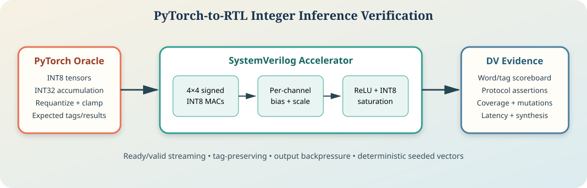
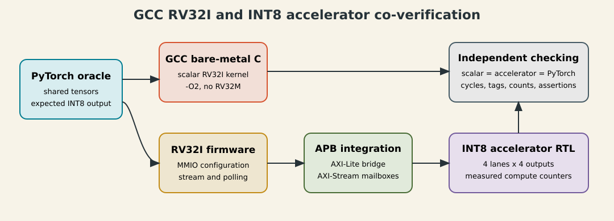
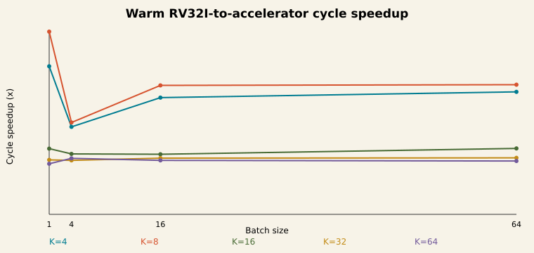
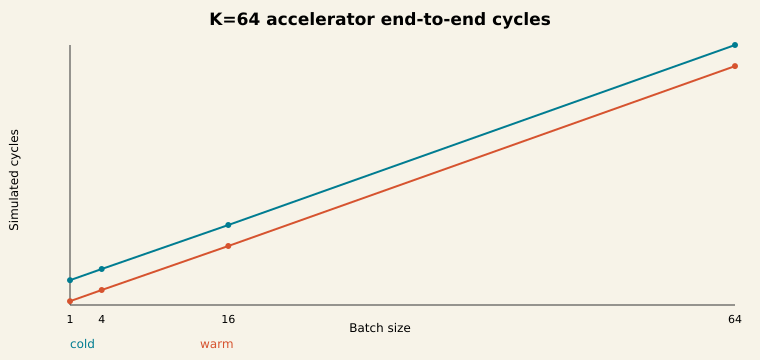
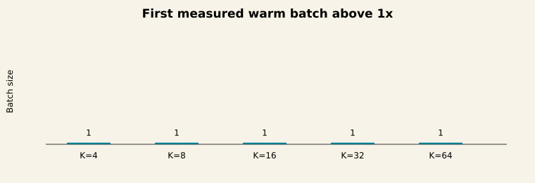
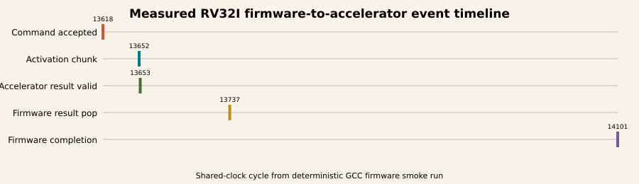
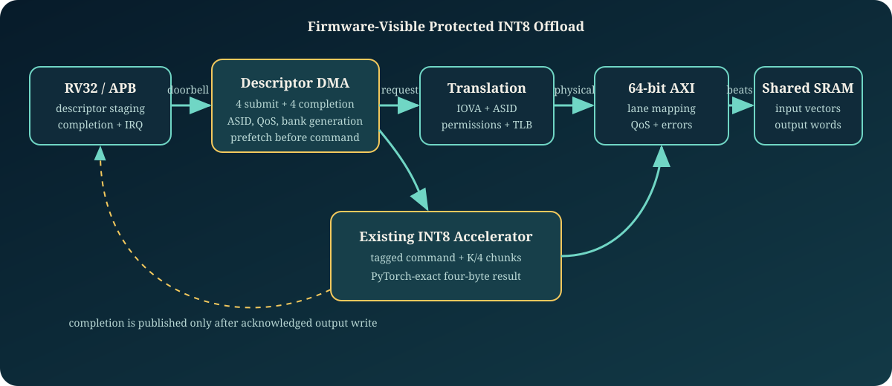
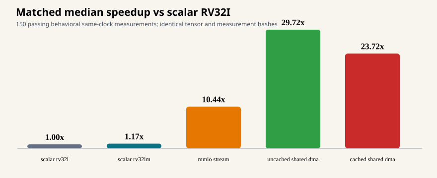

# Tiled INT8 Tensor Accelerator RTL and PyTorch DV

A command-driven quantized linear-layer accelerator implemented in SystemVerilog and checked bit-for-bit against PyTorch. The engine executes configurable `K=4–64` dot products over four output channels, supports double-buffered parameters and asymmetric quantization, and preserves tagged results through a four-entry output FIFO.



## Why This Project

This project is the portfolio's ML/datapath example. It shows how a PyTorch model becomes an explicit integer numerical contract, how that contract maps into multicycle RTL, and how numerical, protocol, performance, and implementation behavior are independently verified.

## Measured Evidence

<!-- BEGIN GENERATED METRICS -->
| Evidence | Result |
| --- | ---: |
| PyTorch-to-RTL comparisons | `130 / 130` |
| Functional coverage | `64 / 64` |
| Interaction crosses | `48 / 48` |
| Two-layer PyTorch/RTL chain | `PASS` |
| Measured steady-state throughput | `0.500 vectors/cycle` |
| Protocol edge checks | `15 / 15` |
| Portable packed-vector checks | `6 / 6` |
| AXI/record integration tests | `3 / 3` |
| AXI/record integration coverage | `17 / 17` |
| Named assertions | `21` |
| Portable monitor assertions | `3` |
| AXI wrapper assertions | `5` |
| RTL mutations detected | `9 / 9` |
| Formal safety/cover groups | `2 / 2` |
| Raw line coverage | `159 / 173 (91.91%)` |
| Reviewed executable line coverage | `159 / 159 (100.00%)` |
| Raw branch/expression coverage | `NA (Verilator 5.020 LCOV)` |
| Yosys synthesis proxy | `PASS` |
| RV32I/accelerator benchmark matrix | `40 / 40` |
| RV32I/accelerator correctness | `25 / 25` |
| RV32I/accelerator backpressure | `15 / 15` |
| RV32I benchmark mutations | `5 / 5` |
| PyTorch FX graphs compiled | `20 / 20` |
| FX graph RTL execution | `PASS` |
| FX compiler coverage | `10 / 10` |
| Protected-offload directed RTL | `40 / 40` |
| Protected-offload seeded RTL | `100 / 100` |
| Protected-offload trace replay | `205 / 205` |
| Protected-offload coverage / crosses | `77 / 77; 64 / 64` |
| Existing protected-offload mutations | `12 / 12` |
| Protected-offload bounded properties | `16 / 16` |
| Protected-offload component checks | `7 / 7` |
| Protected-offload GCC/RV32 execution | `24 / 24` |
| Firmware-owned fabric execution | `32 / 32` |
| Firmware-owned seeded integration | `100 / 100` |
| RV32I/RV32IM compiler matrix | `36 / 36` |
| Cached ownership positive / negative | `8 / 8; 4 / 4` |
| Matched five-path performance | `150 / 150` |
| Single-core chiplet + INT8 orchestration | `2 / 2` |
| Firmware reset epochs | `6 / 6` |
| Firmware page-table recovery | `4 / 4` |
| RV32M compute-crossover directed RTL | `48 / 48` |
| Compute-crossover transaction replay | `48 / 48` |
| Seeded crossover model replay | `100 / 100` |
| Schema-3 crossover smoke replay | `1 / 1` |
| Cache-enabled schema-3 crossover replay | `1 / 1` |
| Crossover checker qualification | `29 negative + 7 controls` |
| Legacy crossover reachability | `34 / 34` |
| Required crossover predicates | `15 / 15` |
| Crossover event-correlated crosses | `53 / 53` |
| Crossover RTL mutations detected | `12 / 12` |
| Crossover formal/property groups | `16 / 16` |
| Crossover raw integrated-top code coverage | `744 / 890 native lines (83.60%); branch 717 / 926 (77.43%); expression 78.34%; toggle 47.38%` |
| Standalone protected-offload line coverage | `raw 289 / 341 (84.75%)` |
<!-- END GENERATED METRICS -->

See [project metrics](docs/project_metrics.md), the [verification plan](docs/verification_plan.md), the [FX graph compiler](docs/fx_graph_compiler.md), and the [two-layer PyTorch demonstration](docs/pytorch_mlp_demo.md).

Supplemental `make compute-live-m-check` verifies each RV32M opcode during
DMA, concurrent AES/INT8, chiplet sleep/resume, and full completion-FIFO
pressure, plus precise IRQ delivery. See the separately reported
[live witnesses](reports/compute_live_m_interactions.csv) and
[opcode/service crosses](reports/compute_live_m_cross_coverage.csv); these do
not inflate canonical coverage or imply exhaustive timing closure.

`make compute-m-permutation-check` expands this with finite operand-class
and observed device-IRQ phase matrices. See the generated
[operand/timing evidence dashboard](docs/compute_crossover_evidence_dashboard.md#finite-operand-and-irq-timing-closure)
for execution counts, bin witnesses, and explicit limits.

## RV32I Hardware/Software Benchmark



An optional integration lane runs GCC `-O2` bare-metal C on a checksum-locked
RV32I/Zicsr core snapshot. Firmware evaluates each quantized layer twice: first
with a scalar software kernel, then by programming this accelerator through APB
to AXI-Lite and streaming activations through MMIO-to-AXI-Stream mailboxes.
Both result sets must match the same PyTorch-generated vectors bit-for-bit before
any performance row is accepted.

The checked-in evidence closes `40 / 40` cold/warm geometry points, `25 / 25`
operand-pattern checks, `15 / 15` backpressure cases, and `5 / 5` expected-fail
mutations. See the [measured benchmark summary](reports/rv32_accel_benchmark_summary.md).

### Measured Dashboard

<!-- BEGIN GENERATED BENCHMARK DASHBOARD -->
| Measured comparison | Result |
| --- | ---: |
| Cold end-to-end speedup | `8.68x - 122.57x` |
| Warm end-to-end speedup | `56.37x - 203.55x` |
| Compute-only speedup | `58.63x - 459.79x` |
| Median cold / warm speedup | `38.13x / 70.29x` |
| First measured warm break-even | `K=4: batch 1, K=8: batch 1, K=16: batch 1, K=32: batch 1, K=64: batch 1` |
| Evidence matrix | `40 / 40` benchmark, `25 / 25` correctness, `15 / 15` backpressure |
<!-- END GENERATED BENCHMARK DASHBOARD -->

| RV32I versus accelerator speedup | K=64 cold versus warm latency |
| --- | --- |
|  |  |
| Warm break-even batch | Firmware-to-accelerator event timeline |
|  |  |

The dashboard is generated from passing behavioral Verilator rows. Review the
[complete 40-row cycle matrix](reports/rv32_accel_benchmark.csv),
[phase breakdown and methodology](reports/rv32_accel_benchmark_summary.md), and
[backpressure results](reports/rv32_accel_backpressure.csv) for the underlying evidence.

## Protected Memory-to-Memory Offload



An optional integration lane adds a four-entry descriptor DMA and completion
FIFO around the existing tensor engine. APB-programmed jobs carry an ASID, QoS,
parameter-bank generation, input/output IOVAs, strides, K, and batch size. The
controller prefetches a complete vector before issuing the accelerator command,
waits for the output memory acknowledgement before success, and reports precise
fault stage and completed-vector count through a level interrupt.

The legacy protected-offload reports retain their historical `40 / 40` directed,
`100 / 100` seeded, compiler, cache-ownership, and matched-performance results.
The newer crossover evidence is intentionally separated: strict replay passes
`48 / 48` directed configurations, each with a separately generated scenario
routine and trace-checked SRAM side effect, plus `100 / 100` seeded
firmware/DMA workloads and `100 / 100` generated RV32M instruction streams.
The setup/teardown harness is shared; the directed scenario routines are
distinct generated images, not 48 independently authored applications.
Trace evidence closes `15 / 15`
required predicates and `53 / 53` versioned event-correlated bins, with
high-risk bins independently witnessed by activating-source provenance, including
`19 / 19` separately authored firmware executions with strict model replay.
These coverage results do not establish overall release closure. The crossover-specific mutation matrix
detects `12 / 12` defects; all `16 / 16` reported formal/property groups pass
with reachable covers, including bounded safety checks and a completion-order
property paired with a strict RTL trace witness. Integrated-top raw code coverage
is `744 / 890` native line points (`83.60%`), branch coverage is
`717 / 926` (`77.43%`), expression coverage is `78.34%`, and raw toggle
coverage is `47.38%`, below its `95%` line / `90%` branch targets. Coverage
includes 48 directed configurations, 100 firmware/DMA seeds, 100 RV32M
instruction streams, and 8 cache-ownership cases. The new
control RTL alone reaches `119 / 124` line (`95.97%`) and `174 / 190` branch
(`91.58%`) coverage with zero reviewed exclusions; imported and
CPU RTL keep the integrated aggregate below target. One APB case explicitly
holds `PREADY` high in SETUP and the release checker verifies one later ACCESS
completion per setup operation. It uses pinned
Verilator 5.049; SVA runs separately in the asserted regression. See the
[evidence dashboard](docs/compute_crossover_evidence_dashboard.md) for the
remaining code-coverage blocker and evidence boundaries.
The dashboard maps each requirement to its stimulus, checker, trace window,
and remaining gap.

The RV32M compute-crossover lane is deliberately reported separately. Its M
arithmetic rows, including interrupt-timing rows, are trace-backed after the
shared dispatch fix. See the [crossover coverage report](reports/compute_crossover_coverage.md)
for predicate witnesses and the distinct interaction-bin model.



See the [architecture and evidence boundary](docs/protected_offload.md)
and [component compatibility audit](docs/protected_offload_compatibility.md).

## Architecture

- Four signed INT8 activation lanes and four output channels in the reviewed baseline.
- Configurable `K=4/8/16/32/64`, processed four activation/weight pairs per output each active cycle.
- Two complete weight/quantization banks; the inactive bank can be configured while the active bank executes.
- Signed INT32 accumulation with per-channel bias.
- Per-channel multiplier, round-to-nearest right shift, output zero point, ReLU, and INT8 saturation.
- Asymmetric input and per-output weight zero points.
- Command validation, tagged streaming chunks, and a four-entry output FIFO.
- Optional AXI-Lite control, AXI-Stream activation/result, and packed-record integration wrappers.
- A parameterized `8×8` structural variant used for synthesis-cost comparison.

The exact behavior is defined in the [numerical contract](docs/numerical_contract.md).

## Verification Flow

1. PyTorch generates 30 directed and 100 seeded-random workloads.
2. The independent model predicts adjusted operands, INT32 accumulators, signed rounded requantization, and final INT8 outputs.
3. The SystemVerilog bench loads either parameter bank, issues a tagged command, and streams every activation chunk.
4. Every RTL result word and tag is compared exactly; floating-point tolerance is never used for RTL checking.
5. A `torch.fx` compiler validates supported graphs, quantizes one-to-three-layer `Linear`/`ReLU` networks, schedules parameter banks, and checks every RTL-observed intermediate and final word.
6. Assertions, protocol-edge tests, functional/cross coverage, RTL mutations, bounded formal checks, code coverage, performance, and synthesis reports are regenerated.
7. A packed transaction stream and synthesizable health monitor provide the same command/result contract for simulation now and a future FPGA host later.

## Reviewer Quick Path

Install `requirements.txt` in the selected PyTorch environment. The optional
protected-offload/combined-host lane also requires
`python -m pip install -r requirements-verification.txt` in that same environment
for its independent AES reference checker.

```bash
make project-check PYTHON=/path/to/pytorch/python
make release-check PYTHON=/path/to/pytorch/python
make portable-check # packed records plus a synthesizable protocol/performance monitor
make axi-integration-check # AXI-Lite, AXI-Stream, decoder, and end-to-end transport checks
make fx-compiler-check # torch.fx graph validation, compilation, bank scheduling, and RTL execution
make rv32-benchmark-smoke # GCC firmware, RV32I, APB/AXI, stream, and PyTorch check
make rv32-benchmark-release-check # optional 40+25+15 matrix and mutations
make protected-offload-release-check # descriptor DMA, model, coverage, formal, mutations
```

High-signal evidence:

- [PyTorch/RTL comparison](reports/rtl_vs_pytorch_summary.csv)
- [Two-layer RTL chain](reports/pytorch_mlp_rtl_summary.csv)
- [PyTorch FX compiler and RTL execution](docs/fx_graph_compiler.md)
- [Functional coverage](reports/functional_coverage.csv)
- [Interaction crosses](reports/cross_coverage.csv)
- [RTL mutation sensitivity](reports/mutation_summary.csv)
- [Performance characterization](docs/performance.md)
- [Formal evidence](docs/formal.md)
- [Synthesis comparison](docs/synthesis.md)
- [Portable validation and FPGA readiness](docs/fpga_readiness.md)
- [AXI and packed-record integration](docs/axi_integration.md)
- [RV32I hardware/software benchmark](docs/rv32_accelerator_benchmark.md)
- [Protected memory-to-memory offload](docs/protected_offload.md)

## Repository Layout

```text
rtl/       synthesizable tiled accelerator RTL
sim/       SystemVerilog benches and bound assertions
formal/    reduced-geometry safety and reachability tasks
portable/  versioned packed command/result vectors for simulation or a future FPGA host
scripts/   PyTorch export, regression, coverage, mutation, and report automation
docs/      reviewer-facing architecture and verification evidence
reports/   normalized checked-in CSV results
integration/rv32_offload/  optional GCC/RV32I hardware-software benchmark lane
integration/protected_offload/  optional protected descriptor-DMA integration lane
```

## Stateful Compute Crossover

Additional [end-to-end lifetime and recovery tests](docs/compute_end_to_end_closure.md)
exercise multi-owner reset, handler/cache/arithmetic overlap, queued invalidation,
repeated cross-stage retries and stable CPU-visible completion records.
The [measured snapshot](reports/compute_end_to_end_closure.md) is generated from
execution-bound traces; these tests do not inflate canonical closure denominators.

<!-- STATEFUL METRICS START -->
Supplemental stateful evidence: **62/62 directed**, **32/32 seeded multi-job workloads**, **35/35 event-correlated crosses**, and **7/7 qualified RTL mutations**. Fresh new-control raw coverage: **119/122 (97.54%) line**, **175/186 (94.09%) branch**. Muldiv remains separately reported: **84.62% line / 94.12% branch**. Canonical denominators are unchanged. [Closure](docs/compute_stateful_closure.md), [advanced ownership/reset closure](docs/compute_gap_closure.md), [cross witnesses](docs/compute_stateful_cross_coverage.md), [code coverage](docs/compute_stateful_code_coverage.md), and [remaining-hole review](reports/compute_stateful_coverage_hole_review.csv).

Independent-peer component evidence: **14/14 asserted/instrumented executions**, covering **12** previously missed wait/containment branches separately from integration coverage. [Tests and boundaries](docs/compute_peer_holes.md).

Advanced closure: **42/42 correlated bins**, **3/3 targeted RTL mutations**, and **3/3 ownership alias/handler negative-control pairs**. [Witnesses and boundaries](docs/compute_gap_closure.md).
<!-- STATEFUL METRICS END -->

## Limitations

- This is a compact linear-layer engine, not a complete NPU, systolic array, training engine, or software compiler.
- RV32I speedups are behavioral same-clock cycle ratios against a scalar `-O2` software kernel. They are not Verilator wall time, silicon frequency, FPGA throughput, power, or implementation signoff.
- The reviewed functional regression uses the `4×4` baseline; `8×8` is separately reported synthesis evidence.
- No convolution frontend, floating point, sparsity, or stochastic rounding is included. The optional protected-offload DMA is a bounded integration lane; it is not AXI/IOMMU certification or a production host subsystem.
- UVM is intentionally not duplicated; the portfolio's AXI4 QoS fabric owns the reusable UVM/VIP story.
- PyTorch, Verilator, SymbiYosys, and Yosys results are open-source pre-silicon evidence, not accuracy certification or physical-design signoff.
