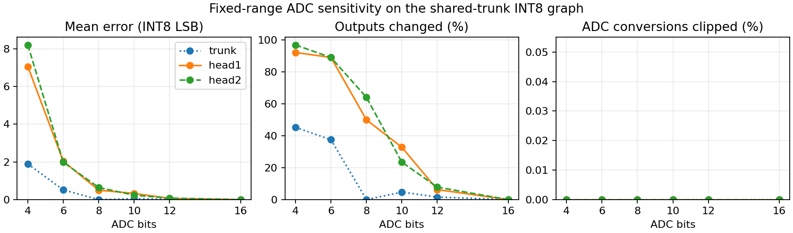

# Compiling a two-layer model for the INT8 accelerator

**DMA chaining saved 3.5–8.7% under AXI contention across three models
imported through torch.fx.** Both schedules were checked byte for byte
against PyTorch. The fixed reference fixture also saved 8.8% at idle. The compiler kept the intermediate activation
in shared memory and passed its address directly to the second DMA descriptor.
This removed a CPU copy, 64 bytes of cache writeback, and two cache
maintenance operations. Both schedules produced exactly the same bytes as
the PyTorch reference.

| Schedule | RTL cycles | Descriptors | DMA payload | Staging writeback | Cache operations |
| --- | ---: | ---: | ---: | ---: | ---: |
| CPU staging | 8,364 | 2 | 448 B | 64 B | 4 |
| DMA chaining | 7,626 | 2 | 448 B | 0 B | 2 |
| CPU consumer present, staging retained | 8,833 | 2 | 448 B | 64 B | 4 |

The fixed-fixture comparison uses the idle fabric and the same RTL, quantized weights,
inputs, and firmware runtime. Cycles include buffer preparation, configuration,
cache maintenance, and interrupt-driven completion. The measurements are
simulation cycles.

## What the compiler changes

The [input MLIR](../compiler/mlir/model.mlir) describes the fixed
16→4→4 Linear/ReLU/Linear workload. A C++ MLIR pass validates the graph and
lowers it to calls into the firmware scheduling ABI. The same pass emits
a C include from those calls so the measured firmware executes the generated
schedule. The FX importer supplies model geometry, weights, biases, shifts, inputs,
and PyTorch expected results. The backend supports batches of 4, 8, or 16
and input widths of 4, 8, 16, 32, or 64, with four outputs per layer.
It accepts a straight-line two- or three-layer graph and the existing signed INT8
quantization contract.

| Staged schedule | Chained schedule |
| --- | --- |
| DMA layer 1 into hidden buffer | DMA layer 1 into hidden buffer |
| Invalidate and copy hidden data through the CPU, then clean staging buffer | Preserve the hidden buffer as the second DMA input |
| DMA layer 2 from staging buffer | DMA layer 2 from hidden buffer |
| Invalidate output before CPU readback | Invalidate output before CPU readback |

The runtime consumes the first descriptor's completion before submitting the
second. Chaining requires a single SSA use of the intermediate in the supported
graph. A recognized CPU observer forces staging and runs after invalidation.
Unknown consumers, unsupported shapes, and unsupported rounding fail lowering.
The RTL runner checks the actual second-layer input addresses, successful
completions, cache writebacks before handoff, and exact PyTorch equality for
intermediate and final data.

## FX models under contention

| Batch × input width | Idle staged → chained | Contended staged → chained | Contended cycles saved |
| --- | ---: | ---: | ---: |
| 4 × 8 | 4,596 → 4,187 | 4,614 → 4,211 | 403 (8.7%) |
| 8 × 32 | 10,003 → 9,520 | 10,087 → 9,604 | 483 (4.8%) |
| 16 × 64 | 20,772 → 20,034 | 21,114 → 20,382 | 732 (3.5%) |

The contender issues four-beat reads at QoS 15 while descriptor DMA uses
QoS 8. All six contended runs observed concurrent DMA and contender
requests and a five-cycle maximum DMA read-address wait. Each schedule
uses two descriptors. Chaining halves cache maintenance from four
operations to two and preserves DMA payload for a given shape.
The percentage gain shrinks on the largest shape because total execution
takes more cycles even though chaining saves more cycles in absolute terms.

## Reproduce

Use LLVM/MLIR 19 development libraries, FileCheck, a C++17 compiler, and the
existing demo dependencies (Verilator, RISC-V GCC/binutils, and PyTorch).

```sh
cmake -S compiler/mlir -B build/int8-mlir -DMLIR_DIR=/usr/lib/llvm-19/lib/cmake/mlir
cmake --build build/int8-mlir
python3 compiler/mlir/compare.py build/int8-mlir/int8-opt /usr/lib/llvm-19/bin/FileCheck
```

The command runs FileCheck on all three schedules, checks rejection of invalid
input, and writes lowered MLIR, firmware includes, trace logs, and
`comparison.csv` and `fx_comparison.csv` under `build/int8-mlir/rtl`.

## Three layers and buffer lifetime

**Chaining reduced simulated cycles by 9.4%** for a 16-sample
32→4→4→4 FX model under AXI contention. The same four-beat QoS 15
contender ran against QoS 8 DMA in both schedules. Firmware and trace
checks matched the PyTorch bytes at both intermediate buffers and at
the final output.

| Schedule | RTL cycles | DMA payload | Descriptors | Cache operations |
| --- | ---: | ---: | ---: | ---: |
| Stage both intermediate activations | 15,609 | 832 B | 3 | 6 |
| Chain both intermediate activations | 14,145 | 832 B | 3 | 2 |

Every DMA call in this ABI waits for the IRQ and consumes the completion.
The lowered calls distinguish the two producer buffers and the reusable
staging slot. The verifier checks producer completion, invalidation before
CPU reads, cleaning before DMA reads of staged data, and the consumer
that releases the slot. The staged schedule reuses the slot after layer
two completes. The chained schedule passes each producer buffer directly
to its consumer. The third layer reloads the first parameter bank after
the earlier completion.

The regression inserts a copy of the middle buffer into the staging slot
before layer two reads the first activation. `int8-opt --verify-schedule`
rejects the modified IR with `premature reuse of live staging buffer`.
A test-only firmware schedule executes the same overwrite and cleans the
slot so the wrong bytes reach DMA. The first layer-two read at
`0x10009000` returns the middle buffer's guard word `0xa53c79e1`.
Firmware rejects the output.

The existing reproduction command runs both schedules and the negative
control. The MLIR CI job publishes `three_layer_comparison.csv`, the
lowered schedules, and `premature_reuse.txt` with the rejection and first
incorrect trace event. The lifetime model covers straight-line two- and
three-layer graphs and the blocking firmware ABI.

## Batch tiling under AXI contention

**Four-vector tiles reduced the longest observed completion on every tested
shape and increased total inference cycles.** The compiler uses the
full batch by default. With `--batch-tiling=auto --axi-contention`, it
uses four-vector tiles when the first descriptor would read more than
64 input words (`batch × input width / 4`). The rule favors fewer
interrupts for small workloads and shorter intervals between completions
for larger ones. `--batch-tiling=full` and `--batch-tiling=four` reproduce
the two fixed policies.

The MLIR pass records the tile length on the lowered schedule. The
blocking firmware ABI advances input and output addresses for each slice
and consumes each IRQ completion before reusing its tag. Layer ownership
and cache maintenance still apply to the full layer. CI checks the exact
descriptor ranges, PyTorch bytes and ordered completion events, and
rejects an invalid tile length.

### Held-out evaluation

The comparison used four-beat QoS 15 read traffic against QoS 8 DMA.
The evaluation goal was the fastest of the two policies with a longest
observed submission-to-consumption interval of at most 1,000 cycles.
The heuristic was set on the basis of the calibration shapes
(8×16, 16×32 and 16×64). All three held-out shapes selected the fastest
measured policy that met the target.

| Held-out workload | Full cycles | Four-vector cycles | Longest completion, full → four | Auto picked |
| --- | ---: | ---: | ---: | --- |
| Batch 16, width 8, two layers | 5,623 | 6,922 | 526 → 193 | Full |
| Batch 8, width 32, two layers | 9,607 | 10,303 | 706 → 385 | Full |
| Batch 8, width 64, three layers | 18,125 | 19,040 | 1,243 → 649 | Four |

For the held-out three-layer model, tiling added three descriptors and
915 cycles while reducing maximum observed completion latency by 594
cycles. Both policies moved 672 payload bytes. The latency target is an
evaluation criterion for these simulations. The heuristic uses static
shape and a contention flag, and it has limited validation across
traffic patterns. The existing reproduction command writes
`batch_tiling.csv` with 18 RTL runs, including the measured automatic
policy, requester overlap, maximum read-address wait and trace hashes.

## Two-head graph and scratch planning

**The compiler reduced reserved scratch payload from 192 to 128 bytes**
for a 16-sample graph with one shared trunk and two output heads. Both
heads consume the same quantized activation. Both policies matched
PyTorch on the trunk and both heads under the same AXI contention.

| Policy | Scratch slots | Scratch payload | RTL cycles | DMA payload | Cache operations | CPU output copies |
| --- | ---: | ---: | ---: | ---: | ---: | ---: |
| Dedicated slots | 3 | 192 B | 15,503 | 832 B | 5 | 128 B |
| Lifetime-based reuse | 2 | 128 B | 15,275 | 832 B | 5 | 128 B |

Scratch payload counts the 64-byte vector arrays assigned to the arena.
The input, cache-line padding, guard words, and two host-owned output
arrays are outside that count. The benchmark uses blocking DMA and
publishes each head's result to host-owned memory before the next head runs.

The FX trace identifies both consumers of the trunk. The lowering assigns
scratch slots using the producer write and final consumer read of each
activation. The trunk stays live through head two. Head one's scratch
slot becomes available after its output has been copied and cleaned.
The verifier checks the supported fan-out schedule's DMA and publish
ordering. `--dedicated-scratch` reserves a separate slot for each activation
for comparison.

The premature-reuse regression inserts a write to the trunk after head
one completes. The compiler rejects the modified schedule. A test-only
firmware include forces the write on RTL and checks that head two reads
`0xa53c79e1` at `0x1000401c` before firmware rejects the result. The
existing reproduction command and MLIR CI lane run both policies and
the regression. See `fanout_comparison.csv`, the lowered IR, and
`fanout_premature_reuse.txt` in the CI evidence.

## PyTorch experiment on ADC precision

The [ADC sweep](../scripts/fanout_adc_sweep.py) reuses the two-head RTL
workload with the same signed inputs, weights, biases, and digital
requantization shifts. It inserts an idealized signed ADC after each
Linear's bias addition and before its digital shift and clamp. The heads
consume the same converted trunk activation, so the experiment includes
the propagation of trunk error.

The sweep uses a fixed nominal half-range of 32,768 accumulator units
for every layer, selected as a simple power-of-two range for the
experiment. At width `b` the code step is `2 ** (16 - b)` accumulator
units. The model rounds to nearest with ties away from zero, clamps to
the signed code range, and decodes by multiplying by the step. The
clipping rate counts rounded codes outside that range before clamping.
The digital INT8 error is measured in output code units against the
existing PyTorch golden bytes.



| ADC bits | Head 1 mean error | Head 2 mean error | Head 1 changed | Head 2 changed |
| ---: | ---: | ---: | ---: | ---: |
| 4 | 7.0625 | 8.2031 | 92.19% | 96.88% |
| 6 | 2.0313 | 1.9844 | 89.06% | 89.06% |
| 8 | 0.5000 | 0.6406 | 50.00% | 64.06% |
| 10 | 0.3281 | 0.2344 | 32.81% | 23.44% |
| 12 | 0.0625 | 0.0781 | 6.25% | 7.81% |
| 16 | 0 | 0 | 0% | 0% |

At 8 bits the trunk matches the golden bytes exactly, yet half the
values in head 1 and nearly two-thirds in head 2 change. None of the
1,152 ADC conversions clipped in this sweep. CPU and CUDA produced
identical bytes and clipping masks on an RTX 5090 with PyTorch 2.7.1.

From the repository root with PyTorch and matplotlib installed, run:

```sh
python scripts/fanout_adc_sweep.py
```

The command checks a hand-calculated clipping and rounding case and
requires ADC bypass to reproduce every trunk and head byte. It writes
`build/fanout-adc/sweep.csv`, `experiment.json`, and `sweep.png`. The JSON
records the exact inputs, parameters, golden bytes, ADC settings,
PyTorch version, and a SHA-256 of the serialized integer fixture.
MLIR CI runs the same check with `--no-plot`. On a CUDA-capable PyTorch
installation, add `--cuda` to require exact CPU/GPU agreement on the
outputs and clipping masks at every bit width.

This is a behavioral approximation for one synthetic workload. It
models fixed-range quantization and clipping. Device dynamics, noise,
hardware timing, and energy are outside the experiment's scope.
