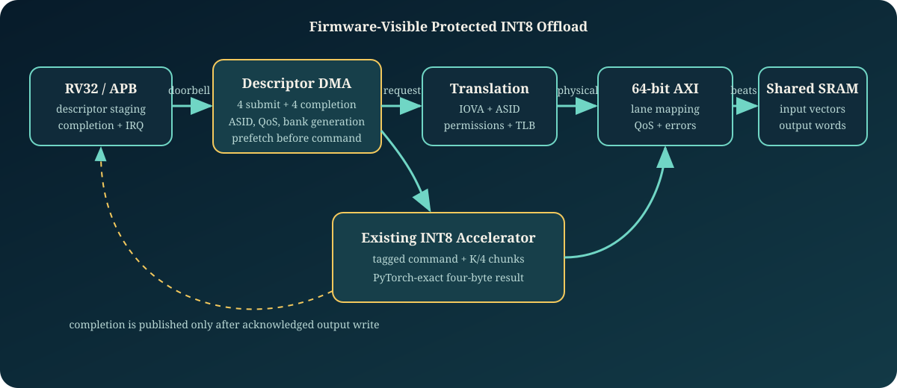
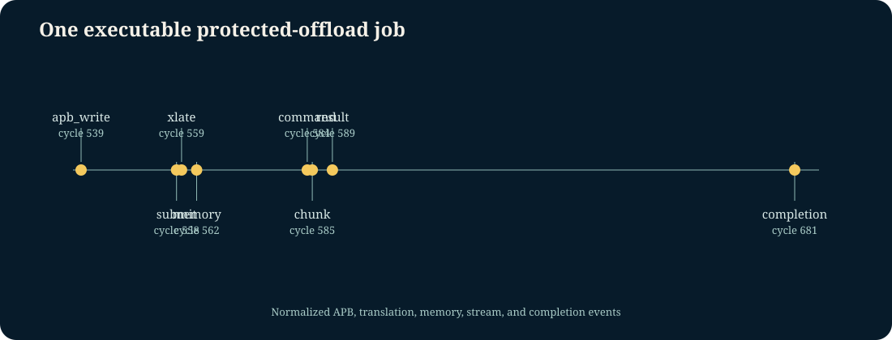
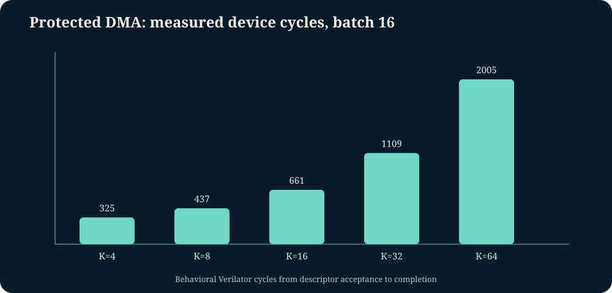
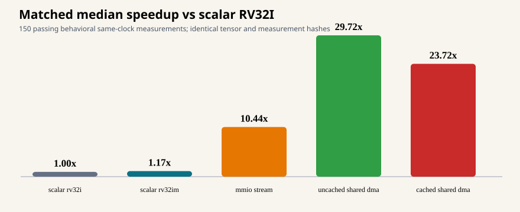

# Protected Accelerator Offload

The integration now includes a CPU-independent `protected_offload_service`
boundary with explicit APB control, payload-memory, page-walk, TLB
invalidation, firmware configuration, interrupt, and performance interfaces.
`make protected-offload-service-check` verifies that boundary elaborates from
the provenance-locked components. The same gate exercises the APB-to-AXI host
bridge, lower/upper 64-bit SRAM lanes, accelerator configuration backpressure,
and set-dominant interrupt aggregation. These are prerequisites, not a claim that the
legacy firmware harness already owns shared-memory or page-table initialization;
that harness remains separately identified where it uses behavioral memory.

The newer `protected-offload-shared-matrix` lane is executable firmware-owned
evidence. GCC firmware writes the two-level page table, tensors, output storage,
weights, biases, scaling, and bank generation through the CPU host interface.
The host, DMA payload, and IOMMU page walker then traverse distinct masters of
the actual QoS fabric. Its `32 / 32` matrix crosses K, batch size, ASID, QoS,
and polling versus machine-interrupt/WFI completion. A companion matrix passes
`36 / 36` executions across `-O0/-O2/-Os` and RV32I/RV32IM. The seeded shared
integration passes `100 / 100` and closes its versioned `47 / 47` executable
points and same-run crosses.

The cached lane inserts the provenance-locked 4-KiB L1 only on the CPU payload
path. Firmware explicitly flushes before device ownership and invalidates before
CPU reuse. It passes `8 / 8` positive cases, while `4 / 4` intended-negative
cases prove that omitted maintenance, a late dirty writeback, and CPU access
during device ownership are detected.

### Combined Host and Reset Evidence

`make compute-host-check` runs two GCC-built firmware images on **one** RV32I
core. The firmware initializes and verifies the protected INT8 DMA job through
the four-master AXI fabric, then stages a four-word chiplet DMA job through the
optional chiplet CSR window at `0x5000_0000`. The checked-in
[`compute_host_summary.csv`](../reports/compute_host_summary.csv) records both
passing executions; this is software orchestration of independent AES and INT8
services, not an invented AES-to-INT8 data pipeline.

`make protected-offload-error-reset` injects reset at four deterministic
firmware phases. Each run restarts the ROM program, reinitializes
firmware-owned page tables and buffers through the host bridge, and reaches the
normal mailbox without accepting a pre-reset completion. The separately
reported [`protected_error_reset_summary.csv`](../reports/protected_error_reset_summary.csv)
is reset evidence only. `make protected-offload-error` runs four firmware-owned
recovery cases: invalid input PTE, invalid output PTE, output write-permission
denial, and partial-output recovery. The final case commits vector zero, faults
vector one through the error target, reads the completion count/status, pops the
failed completion, repairs the vector-one PTE, performs a targeted ASID TLB
invalidation, and resubmits the same tag. The final retry verifies both output
locations. This is bounded software recovery evidence, not a general IOMMU
driver or transactional rollback claim.

This optional integration lane turns the tensor engine into a memory-to-memory
device. Software snapshots a descriptor through APB, the four-entry DMA queue
translates each input and output address, fetches a complete vector, streams it
through the existing INT8 engine, waits for the output write response, publishes
a completion record, and holds a level interrupt until software pops that record.



## Measured Evidence

| Evidence | Result | What actually ran |
| --- | ---: | --- |
| Directed RTL scenarios | `40 / 40` | Descriptor geometry, backpressure, faults, completion pressure, ASIDs, QoS |
| Seeded RTL scenarios | `100 / 100` | Deterministic K, batch, context, stall, fault, and completion-hold combinations |
| Independent trace replay | `205 / 205` | Python orchestration plus compiled C++ model, 5,182 ordering/numerical/accounting checks |
| Functional points | `77 / 77` | Event-derived controller, operand, protection-boundary, recovery, and concurrency intent |
| Interaction crosses | `64 / 64` | Dedicated same-execution knob and event combinations |
| RTL mutations | `10 / 10` | Expected failures in numerical, context, permission, ordering, and IRQ paths |
| Guard/queue/AXI/IOMMU checks | `4 / 4` | Descriptor legality, simultaneous queue accounting, lane/error, and translation/TLB cases |
| Solver properties | `10 / 10` | Eight bounded AXI-adapter checks plus two queue-accounting proofs; reachable covers |
| GCC firmware execution | `24 / 24` | Eight workflows at `-O0`, `-O2`, and `-Os` booted on RV32 and completed through APB/DMA |
| Shared-fabric firmware | `32 / 32` | Firmware initializes page tables/data; host, DMA, and PTW use the actual QoS fabric |
| Compiler/ISA matrix | `36 / 36` | `O0/O2/Os` crossed with RV32I/RV32IM |
| Shared integration random | `100 / 100` | Deterministic K, batch, ASID, QoS, IRQ, and ISA variation |
| Cached ownership | `8 / 8` positive; `4 / 4` negatives detected | Flush/fence/device/invalidate/fence handoff |
| Shared integration coverage | `47 / 47` | Versioned executable predicates; separate from controller-model coverage |
| Code coverage | raw `289 / 341` (`84.75%`); reviewed `289 / 289` (`100%`) | 52 declaration/interface/case-attribution exclusions remain denominator-visible |
| Performance comparison rows | `45 / 45` | Scalar RV32I, MMIO stream, and autonomous DMA cycle evidence |
| Matched five-path benchmark | `150 / 150` | Same tensors and `mcycle` contract: RV32I, RV32IM, MMIO stream, uncached DMA, cached DMA |

| Executable job timeline | Device-cycle scaling |
| --- | --- |
|  |  |

The matched benchmark uses one all-ones tensor/quantization contract at five K
values, three batch sizes, and cold/warm parameter modes. Its median measured
speedups versus scalar RV32I are `1.171x` for RV32IM, `10.440x` for MMIO stream,
`29.717x` for uncached shared DMA, and `23.722x` for cached shared DMA. These
are same-clock behavioral cycle ratios, not frequency, power, FPGA, or silicon
claims. Raw rows and hashes are in `protected_offload_matched_performance.csv`.



The checked-in GCC matrix separately records build and execution status, ELF
hash, instruction image size, simulated cycles, and retired instructions. Each
program boots on the provenance-locked RV32 core, programs the descriptor CSRs
through APB, waits for the level completion interrupt, validates the completion,
and publishes a result mailbox checked against output memory. The executable
path uses the locked educational IOMMU, performs two-level page walks, and
records TLB activity per firmware run. Cache-maintenance ownership evidence is
recorded in `protected_cache_ownership.csv` and `protected_cache_negative.csv`.

## Descriptor and Completion Contract

The doorbell snapshots input/output IOVAs, independent strides, `K`, batch,
tag, ASID, parameter bank/generation, and QoS. Invalid geometry, duplicate live
tags, queue pressure, and stale parameter generations are rejected before work
starts. The completion records tag, status, ASID, faulting IOVA, failing stage,
and the number of fully acknowledged output vectors.

Each vector follows this ordering:

1. Translate and fetch all `K/4` input words.
2. Issue one tagged accelerator command and exactly `K/4` stream chunks.
3. Collect one four-byte result.
4. Translate the output and issue a byte-lane-correct memory write.
5. Wait for the write response before incrementing `vectors_done`.
6. Publish one completion after the final acknowledged vector.

## Protection and Error Semantics

The executable controller carries the descriptor ASID and QoS with every
request and stops before issuing an accelerator command when input translation
or memory access fails. Output translation and write failures publish distinct
stage/status information. Successful earlier vectors remain committed; the lane
does not claim rollback of an AXI write that returns an error.

Descriptor guards reject invalid geometry, stale generation, overlap, and
32-bit address overflow. The descriptor queue is separately stressed for simultaneous dequeue/enqueue,
full occupancy, ordering, and backpressure. The imported educational IOMMU is
integrated in the RV32 firmware path and is also separately exercised for page
walk, TLB hit, ASID separation, invalidation, and permission denial. The DMA-to-AXI adapter is
separately exercised for lower/upper 32-bit lanes, independent AW/W waits,
read/write responses, and error propagation. The four-master QoS fabric is
exercised by firmware-owned host, payload DMA, and page-walk traffic. The
cached-host path is separately checked; neither is an AXI compliance claim.

## Reviewer Commands

```bash
make protected-offload-smoke
make protected-offload-service-check
make protected-offload-shared-matrix
make protected-offload-shared-compiler
make protected-offload-shared-random
make protected-offload-error
make protected-offload-error-reset
make compute-host-check
make protected-offload-cache-ownership
make protected-offload-components
make protected-offload-directed
make protected-offload-firmware
make protected-offload-random
make protected-offload-model-check
make protected-offload-coverage
make protected-offload-formal
make protected-offload-mutations
make protected-offload-performance
make protected-offload-matched-performance
make protected-offload-release-check
```

This is behavioral open-source pre-silicon evidence. It is not AXI compliance,
IOMMU certification, production firmware, cache coherence, or implementation
signoff. Half of the shared-fabric matrix polls; half uses machine external
interrupts, WFI, trap entry, completion draining, acknowledgement, and MRET.
